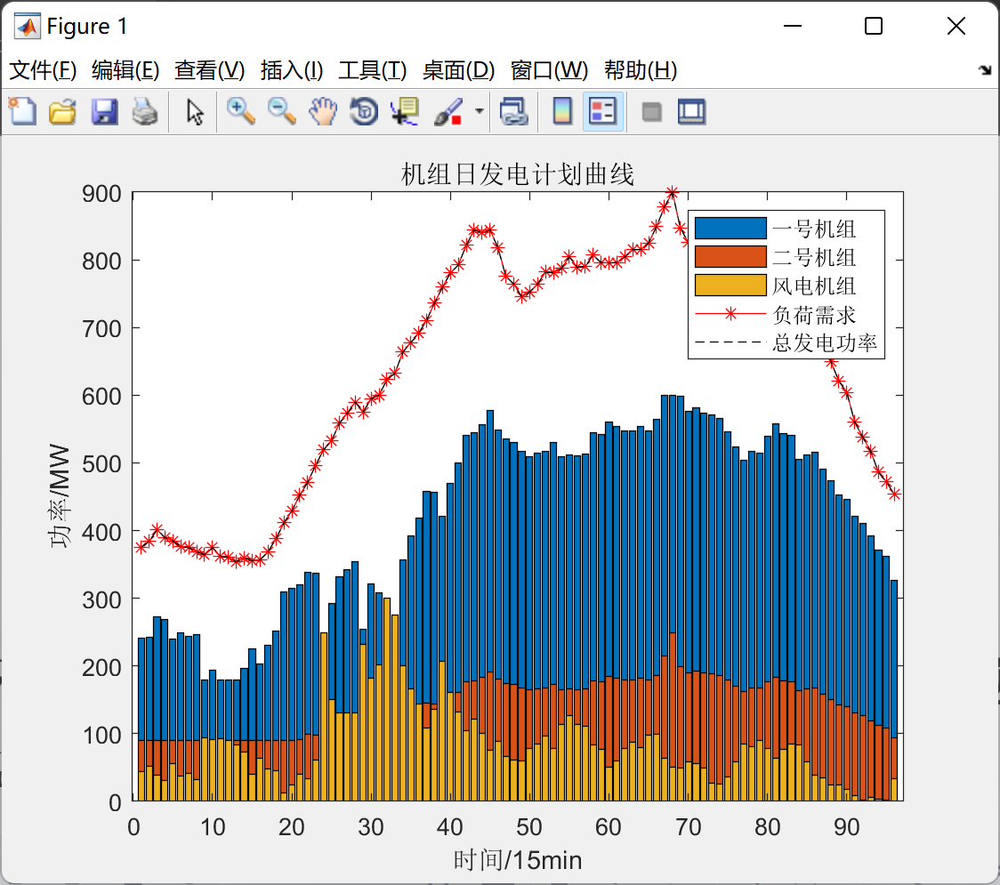
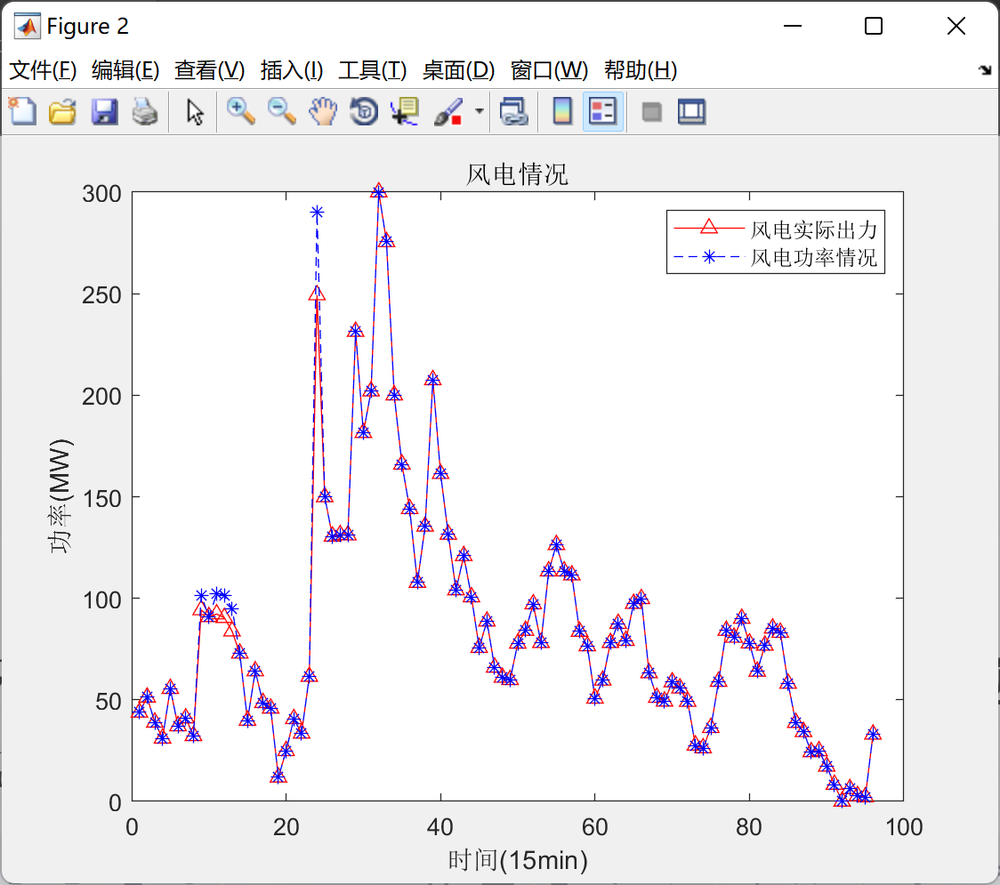
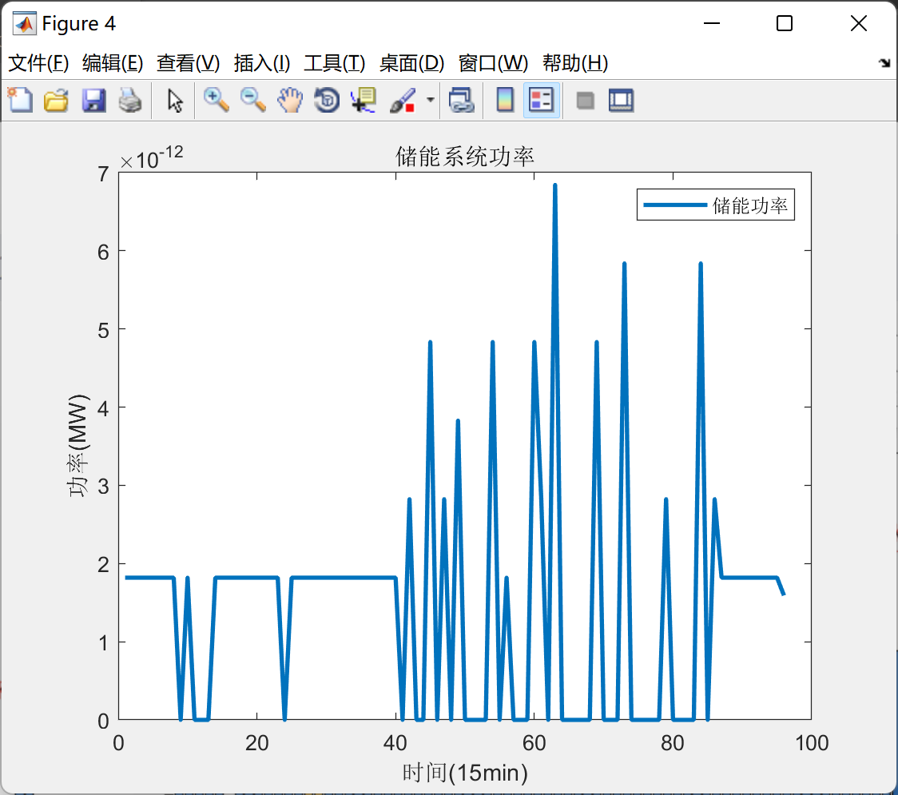

# Analysis of Energy Storage Operation and Configuration in High-Ratio Wind Power Systems (Matlab Code + Data)

High-Proportion Wind Power System Energy Storage Operation and Configuration Analysis Question 5 (Matlab Code + Data)
Only a portion is shown.
\n        \n      \n        \n      \n        \n

## Images

<!-- PAYMENT_BLOCK -->

## Get this dataset

- Payment link (Stripe): [Buy now](https://buy.stripe.com/3cs8yP7sY87d0vu9AB)
- Payment QR code: 

<!-- /PAYMENT_BLOCK -->
